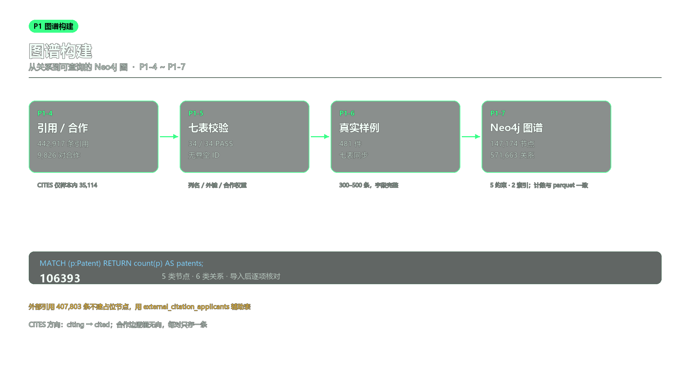
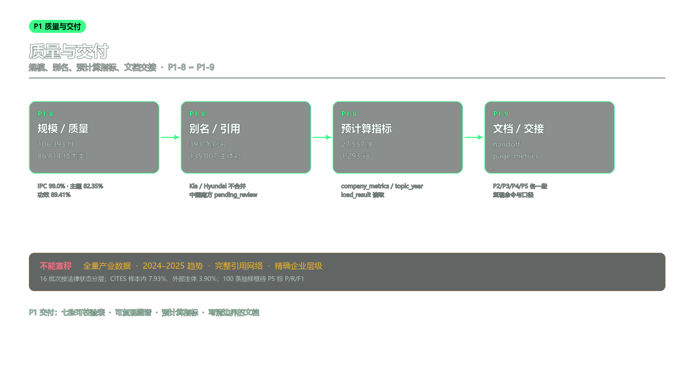

# P1 答辩 PPT 大纲（3 页，按 P1-1 ~ P1-9）

> 适用：团队 12 分钟答辩 + 3 分钟演示，P1 部分约 **3 分钟**。
> 分组：**知识建模（P1-1~P1-3）→ 图谱构建（P1-4~P1-7）→ 质量与交付（P1-8~P1-9）**。
> 三张图都是**透明底 PNG、浅色字、荧光绿线条**，直接叠在深色 PPT 上；不要给图片加白底。
> 第一页只讲知识建模：七表契约、实体关系、约束接口；不单独列“数据获取”。

## 开场（约 10 秒）

> “我负责 P1 的数据与图谱，按 9 个步骤压缩成三页：知识建模、图谱构建、质量与交付。先讲知识建模，也就是七表契约、实体关系和接口约束。”

---

# 第 1 页：知识建模（P1-1 ~ P1-3）

> 透明底流程图：只有“字段梳理 → 七表契约 → 实体与关系 → 约束与接口”，没有标题和页面装饰；直接放到深色 PPT 上。

## 我做了什么

- **字段梳理**：把公开号、申请号、申请人、IPC、主题、功效等原始字段，归并成能支撑业务问题的字段集合。
- **七表契约**：定为 `patents`、`applicants`、`patent_ipc`、`patent_topic`、`patent_efficacy`、`citations`、`cooperation`，列名、顺序、外键一次冻结。
- **实体与关系**：设计 5 类节点（Patent / Applicant / IPC / Technology / Domain）和 6 类关系（APPLIES_FOR / CITES / HAS_IPC / INVOLVES / BELONGS_TO / CO_APPLIED_WITH）。
- **约束与接口**：确定唯一键、外键和读取入口 `load_table` / `run_query`，让表、图、页面用同一套契约。

## 结果如何

- 七张表结构固定，`patent_id` 唯一，子表没有悬空 ID。
- 图谱 Schema 固定为 5 类节点、6 类关系；后续建图不需要再改模型。
- P2/P3 可以直接按契约读表或查图，不需要再问“字段是什么意思”。

## 作用是什么

- **不返工**：模型先定，后面的抽取、建图、页面都按同一套字段做。
- **可解释**：每个图上的节点/关系都能对应回七张表。
- **可交接**：P2/P3/P4/P5 看同一份 Schema 和字段说明，不用口头对齐。

## 讲稿（约 60 秒）

> “第一页只讲知识建模。我先梳理原始字段，再把它们收敛成七张表：专利、申请人、IPC、主题、功效、引用、合作，列名、顺序、外键一次冻结。然后在这个表结构上设计图模型：5 类节点、6 类关系，明确引用方向、合作边和唯一键。最后确定读取接口：表用 `load_table`，图用 `run_query`，预计算指标用 `load_result`。这样做的结果是，七张表和图谱 Schema 都固定下来，后面的抽取、建图、页面不用再改模型；P2/P3 可以直接按契约开发，P4/P5 也能按同一份字段说明写文档和验收。”

---

# 第 2 页：图谱构建（P1-4 ~ P1-7）

> 透明底示意图：引用/合作 → 七表校验 → 真实样例 → Neo4j 图谱。

## 页面文字

- **P1-4 引用 / 合作**：引用 442,917 条、合作 9,826 对；CITES 只建样本内 35,114 条
- **P1-5 七表校验**：34 / 34 PASS，无悬空 ID，列名/外键/合作权重一致
- **P1-6 真实样例**：481 件，七表同步，字段完整
- **P1-7 Neo4j 图谱**：147,174 节点、571,663 关系、5 约束、2 索引
- 查询结果：`MATCH (p:Patent) RETURN count(p)` → **106393**
- 外部引用 407,803 条不建占位节点，用 `external_citation_applicants` 辅助表

## 讲稿（约 70 秒）

> “第二页是图谱构建，覆盖 P1-4 到 P1-7。引用 442,917 条、合作 9,826 对；CITES 只建样本内 35,114 条，外部 40.7 万条不建占位节点。七表校验 34 项全过，没有悬空 ID；再抽 481 件真实样例做开发与联调。最后把七张表导入 Neo4j Desktop 2026.10.2，得到 147,174 个节点、571,663 条关系，5 个约束、2 个索引，节点和关系数与 parquet 逐项一致。这句查询返回 106393，三条固定查询和企业→被引专利→申请人两跳都跑通了。”

---

# 第 3 页：质量与交付（P1-8 ~ P1-9）

> 透明底示意图：规模/质量 → 别名/引用 → 预计算指标 → 文档/交接。

## 页面文字

- **P1-8 规模 / 质量**：106,393 件；技术类 86,814；IPC 99.0%、主题 82.35%、功效 89.41%
- **P1-8 别名 / 引用**：393 条别名；企业级引用 135,007 个主体对
- **P1-8 预计算指标**：`company_metrics` 27,557 家；`topic_year` 1,293 行；`load_result` 读取
- **P1-9 文档 / 交接**：handoff、page_metrics、schema、run、data_profile
- 不能宣称：全量产业数据、2024—2025 趋势、完整引用网络、精确企业层级
- 16 批次不是随机全量；CITES 样本内 7.93%、外部主体 3.90%；100 条抽样框待 P5 标 P/R/F1

## 讲稿（约 70 秒）

> “第三页是质量和交付，覆盖 P1-8、P1-9。规模上是 106,393 件专利、86,814 件技术类，IPC 99%、主题 82.35%、功效 89.41%。别名 393 条只是展示层，Kia 和 Hyundai 不合并，中国南方标待核；企业级引用 135,007 个主体对。P1 还生成了 company_metrics 27,557 家、topic_year 1,293 行，P2/P3 用 load_result 直接读。最后是边界：16 批次不是随机全量，2024—2025 不完整，CITES 只有样本内、外部主体覆盖 3.90%，不能说是全产业引用网；P5 的 100 条抽样框已经交了，P/R/F1 还要人工标注后算。”

---

# 收尾（约 10 秒）

> “P1 的 9 步最后收敛成四样东西：可校验的七张表、可复现的 Neo4j 图、可被 P2/P3 读取的预计算指标，以及写清楚边界的文档。”

---

# 可能追问（不占页）

**Q1：9 步为什么压成 3 页？**
> 按“建模 → 建图 → 交付”三条主线合并；每页标了 P1-1~P1-3、P1-4~P1-7、P1-8~P1-9，细节在文档里，不逐条念。

**Q2：为什么按申请号，不按公开号？**
> 同一申请会有申请、授权多次公开，按公开号会重复计数；申请号才是“一件专利”。代表公开号按授权优先，保证技术内容完整。

**Q3：为什么 CITES 只有 3.5 万条？**
> 只把样本内专利作为引用方；外部被引 40.7 万条没有建占位节点。企业级依赖用 `external_citation_applicants` 明细，结论标覆盖率和样本量。

**Q4：企业别名为什么只有 393 条？**
> 只做展示层，不做完整实体消解；合并同主体变体、截断名和少量集团级。Kia 和 Hyundai 不合并，`中国南方` 待核。

**Q5：2024—2025 和 P/R/F1 呢？**
> 2025 年数据只到 8 月导出，2024 申请 6,519、2025 申请 236，不能做趋势结论；100 条抽样框已交 P5，P/R/F1 要人工标注后算。
