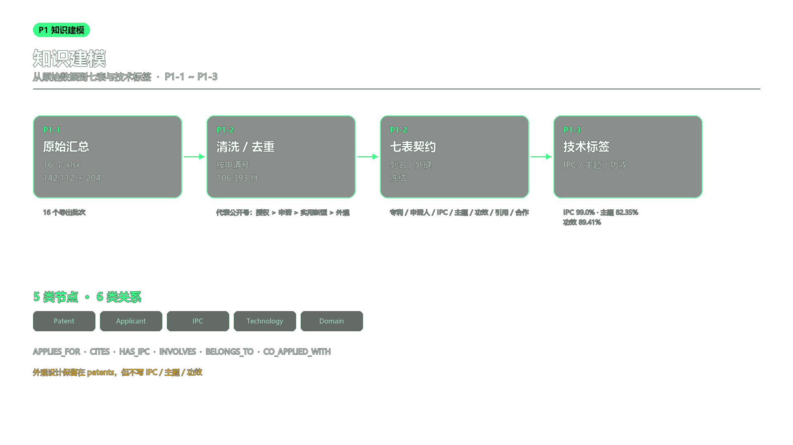
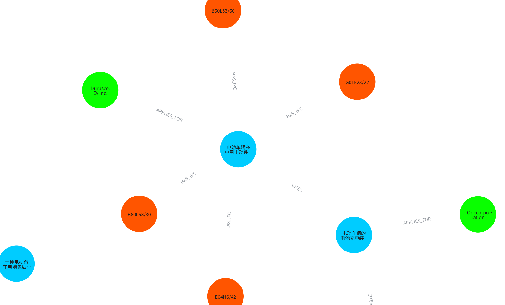
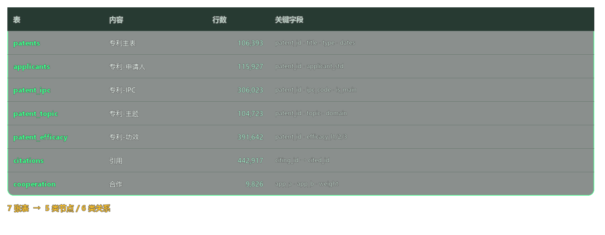

# P1 答辩 PPT 大纲（3 页，按 P1-1 ~ P1-9）

> 适用：团队 12 分钟答辩 + 3 分钟演示，P1 部分约 **3 分钟**。
> 分组：**知识建模（P1-1~P1-3）→ 图谱构建（P1-4~P1-7）→ 质量与交付（P1-8~P1-9）**。
> 三张图都是**透明底 PNG、浅色字、荧光绿线条**，直接叠在深色 PPT 上；不要给图片加白底。
> 第一页只讲知识建模：七表结构、实体关系和读取接口；不单独列“数据获取”。

## 开场（约 10 秒）

> “我负责 P1 的数据与图谱，按 9 个步骤压缩成三页：知识建模、图谱构建、质量与交付。先讲知识建模，也就是七表结构、实体关系和读取接口。”

---

# 第 1 页：知识建模（P1-1 ~ P1-3）

> 透明底流程图：只有“字段梳理 → 七表结构 → 实体与关系 → 编号与接口”，没有标题和页面装饰；直接放到深色 PPT 上。

## 我做了什么

- **字段梳理**：把公开号、申请号、申请人、IPC、主题、功效等原始字段，归并成能支撑业务问题的字段集合。
- **七表结构**：定为 `patents`、`applicants`、`patent_ipc`、`patent_topic`、`patent_efficacy`、`citations`、`cooperation`，列名、顺序、表间对应关系一次定好。
- **实体与关系**：设计 5 类节点（Patent / Applicant / IPC / Technology / Domain）和 6 类关系（APPLIES_FOR / CITES / HAS_IPC / INVOLVES / BELONGS_TO / CO_APPLIED_WITH）。
- **编号与接口**：确定唯一编号、表间对应关系和读取入口 `load_table` / `run_query`，让表、图、页面用同一套字段规则。

## 结果如何

- 七张表结构固定，`patent_id` 唯一，子表没有悬空 ID。
- 图谱结构固定为 5 类节点、6 类关系；后续建图不需要再改模型。
- P2/P3 可以直接按这套表结构读表或查图，不需要再问“字段是什么意思”。

## 作用是什么

- **不返工**：模型先定，后面的抽取、建图、页面都按同一套字段做。
- **可解释**：每个图上的节点/关系都能对应回七张表。
- **可交接**：P2/P3/P4/P5 看同一份图谱结构和字段说明，不用口头对齐。

## 讲稿（约 60 秒）

> “第一页只讲知识建模。我先梳理原始字段，再把它们收敛成七张表：专利、申请人、IPC、主题、功效、引用、合作，列名、顺序、表间对应关系一次定好。然后在这个表结构上设计图模型：5 类节点、6 类关系，明确引用方向、合作边和唯一编号。最后确定读取接口：表用 `load_table`，图用 `run_query`，预计算指标用 `load_result`。这样做的结果是，七张表和图谱结构都固定下来，后面的抽取、建图、页面不用再改模型；P2/P3 可以直接按这套表结构开发，P4/P5 也能按同一份字段说明写文档和验收。”

---

# 第 2 页：数据处理与图谱（P1-4 ~ P1-7）

> 实际 Neo4j Bloom 局部图：蓝色是 Patent，绿色是 Applicant，橙色是 IPC；边上标 `APPLIES_FOR`、`HAS_IPC`、`CITES`。

> 七张表结构：表名、内容、行数、关键字段；底部是“7 张表 → 5 类节点 / 6 类关系”。

## 我做了什么处理

- **建关系**：从七张表生成引用 442,917 条、合作 9,826 对；引用只取样本内作为引用方。
- **做校验**：七表结构校验 34 / 34 通过，没有悬空编号，合作权重和共同专利数一致。
- **抽真实样例**：从全量抽 481 件真实专利，七表同步，给 P2/P3 做开发联调。
- **导入图谱**：把七张表导入 Neo4j，147,174 个节点、571,663 条关系。

## 处理成啥样

- 七张表的规模：patents 106,393、applicants 115,927、IPC 306,023、主题 104,723、功效 391,642、引用 442,917、合作 9,826。
- 图谱结构：5 类节点、6 类关系；5 个唯一编号规则、2 个索引；节点/关系数与数据表逐项核对一致。
- 查询验证：`MATCH (p:Patent) RETURN count(p)` → **106393**；三条固定查询和两跳路径都跑通。
- 外部引用 407,803 条不建占位节点，用 `external_citation_applicants` 辅助表补。

## 为什么这么处理

- **表结构先固定，图直接按表建**：每个节点/关系都能追溯回七张表，不会出现“图上看得到、表里找不到”。
- **引用只建样本内**：外部 40.7 万条没有完整主体，硬建节点会制造假全量；外部依赖改用辅助表，结论标覆盖率。
- **先校验再建图**：34 项校验通过后再导入，避免把悬空编号、错误合作权重带进图。
- **抽真实样例**：P2/P3 不用等全量图，481 件样例足够联调；样例和全量同名同列，切换只改 `USE_SAMPLE`。

## 讲稿（约 70 秒）

> “第二页是数据处理和图谱，覆盖 P1-4 到 P1-7。我先用七张表生成引用和合作关系：引用 442,917 条、合作 9,826 对；再做七表校验，34 项全过，没有悬空编号；抽 481 件真实样例做联调。然后把七张表导入 Neo4j，得到 147,174 个节点、571,663 条关系。右边是实际图谱局部：蓝色是专利、绿色是申请人、橙色是 IPC，边上能看到 APPLIES_FOR、HAS_IPC、CITES。为什么这么处理：表结构先固定，图直接按表建，每个节点和关系都能追溯；引用只建样本内 35,114 条，外部 40.7 万条没有建占位节点，用辅助表补，避免把不完整的引用网说成全量。”

---

# 第 3 页：总结与交付（P1-8 ~ P1-9）

> 本页不放图片，只做总结；具体数字和图表在前两页已经展示，这里不重复。

## 我做了什么

- 在数据建模和图谱构建之后，完成质量核验、企业名称归一、引用关系聚合和页面指标预计算。
- 把分散的处理结果整理成可复用的数据资产和交接文档，明确数据边界和使用口径。

## 结果如何

- 数据链路可复现：从原始数据到七张表、再到图谱，每一步都有校验结果。
- 页面所需的企业排名、合作网络、技术布局、主题趋势和引用分析，都有对应的数据表或查询入口。
- 已知局限被单独记录，避免下游把“研究数据集”误当成“全量产业数据”。

## 给做网页的同学提供了什么

- **P2（产业全景/创新主体）**：企业专利数、合作关系、企业指标、主题年度统计和展示层企业名称表。
- **P3（智能问答/关联路径）**：Neo4j 查询入口、引用关系覆盖说明、企业级引用辅助表和企业名称归一表。
- **P2/P3 共用**：`load_table` / `load_result` / `run_query` 三个取数入口，样例与全量同名同列、通过 `USE_SAMPLE` 切换，以及页面口径文档。
- **P4/P5**：同一套数据说明、质量报告和抽样框，用于写文档、做评估和提交材料。

## 讲稿（约 70 秒）

> “最后我做一次总结。除了前面的数据建模和图谱构建，我还完成了质量核验和交付整理：检查七张表的规模、覆盖率、缺失和关系一致性；对企业名称做展示层归一；把引用关系整理成企业级聚合；并把页面需要的排名、网络指标和主题年度统计预计算成结果表。最终形成的不是单个文件，而是一套可以直接复用的数据资产：七张表、一个可查询的图谱、一份质量报告、企业别名和指标表，以及人工抽样框。对后面做网页的同学，我主要提供了三层支持：第一，统一取数接口，P2 用 `load_table` 和 `load_result` 读表与指标，P3 用 `run_query` 查图；第二，样例和全量同名同列，通过 `USE_SAMPLE` 切换，前端不需要改代码；第三，页面口径文档，明确分母、时间窗口、引用覆盖率和哪些结论不能下。这样 P2 和 P3 可以在不接触底层数据的情况下完成页面和问答，P4 和 P5 也能按同一套口径写文档和验收。”

---

# 收尾（约 10 秒）

> “P1 的 9 步最后收敛成四样东西：可校验的七张表、可复现的 Neo4j 图、可被 P2/P3 读取的预计算指标，以及写清楚边界的文档。”

---

# 可能追问（不占页）

**Q1：9 步为什么压成 3 页？**
> 按“建模 → 建图 → 交付”三条主线合并；每页标了 P1-1~P1-3、P1-4~P1-7、P1-8~P1-9，细节在文档里，不逐条念。

**Q2：为什么按申请号，不按公开号？**
> 同一申请会有申请、授权多次公开，按公开号会重复计数；申请号才是“一件专利”。代表公开号按授权优先，保证技术内容完整。

**Q3：为什么 CITES 只有 3.5 万条？**
> 只把样本内专利作为引用方；外部被引 40.7 万条没有建占位节点。企业级依赖用 `external_citation_applicants` 明细，结论标覆盖率和样本量。

**Q4：企业别名为什么只有 393 条？**
> 只做展示层，不做完整实体消解；合并同主体变体、截断名和少量集团级。Kia 和 Hyundai 不合并，`中国南方` 待核。

**Q5：2024—2025 和 P/R/F1 呢？**
> 2025 年数据只到 8 月导出，2024 申请 6,519、2025 申请 236，不能做趋势结论；100 条抽样框已交 P5，P/R/F1 要人工标注后算。
