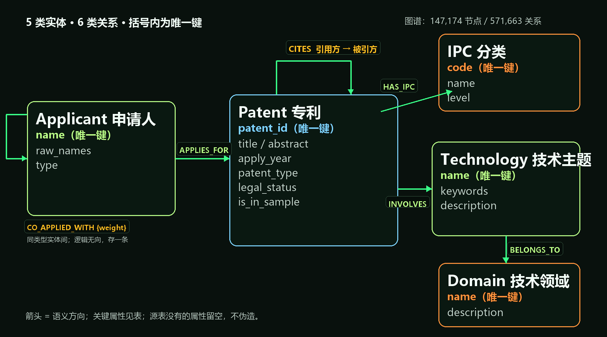
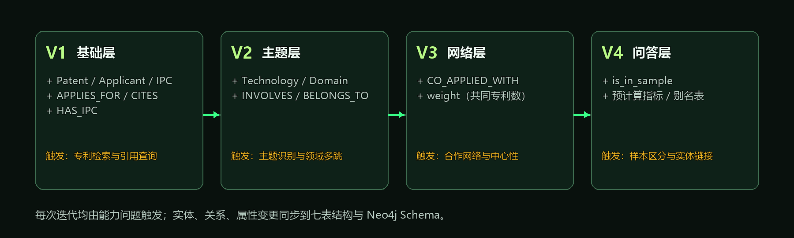
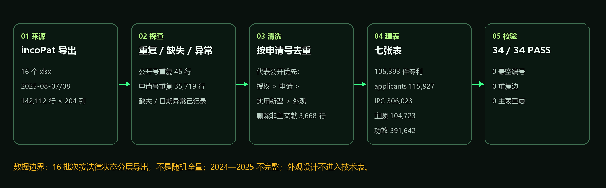
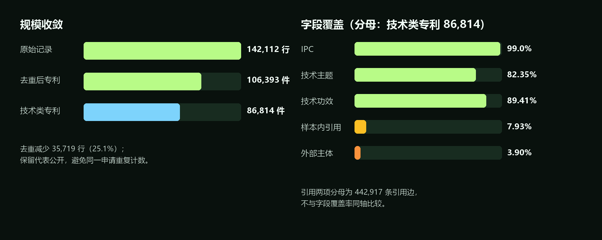
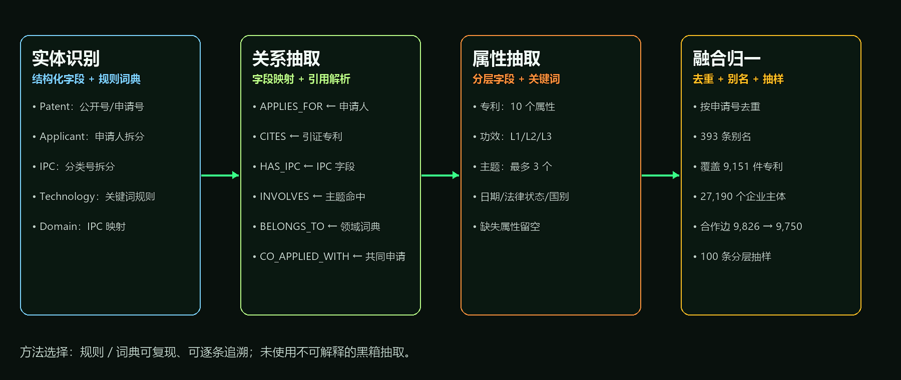
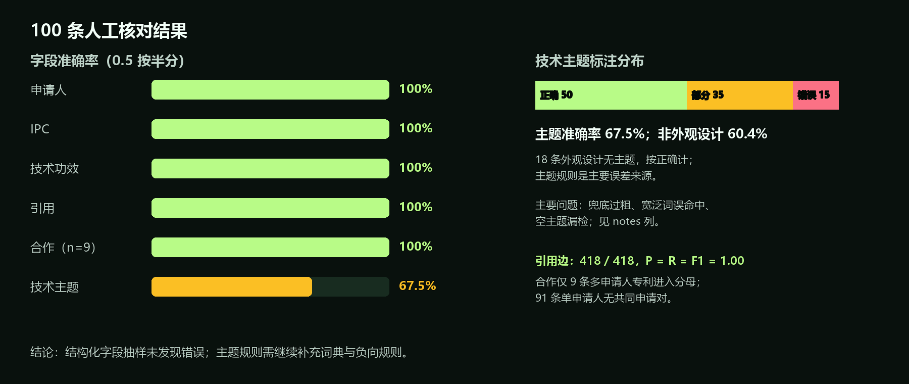
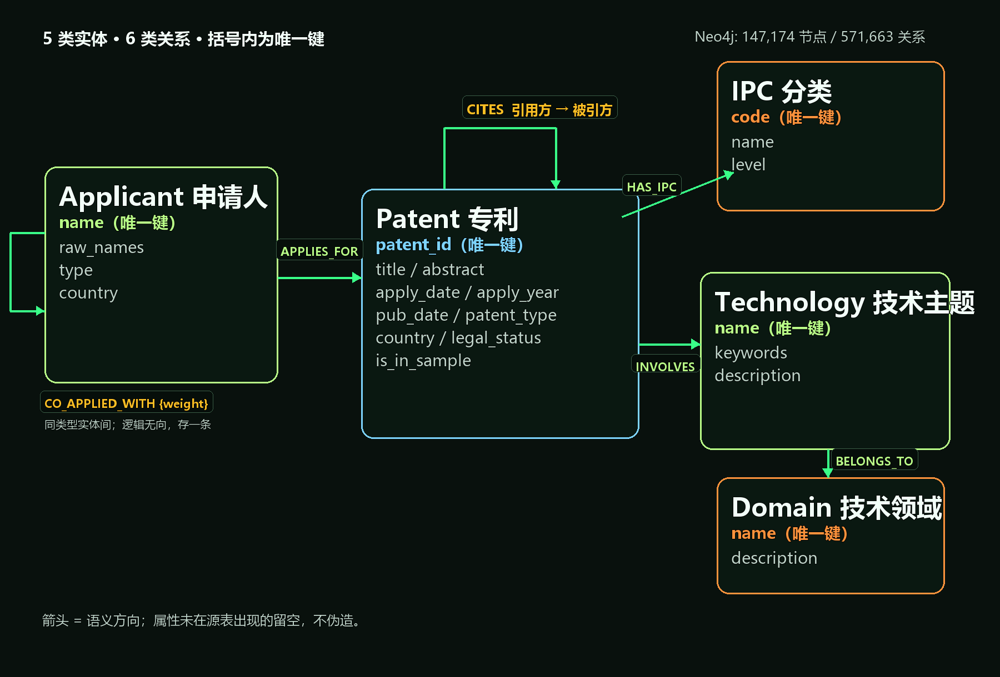

# P1 汇报大纲：知识建模、数据获取、知识抽取与融合

> 对应作业要求第 **2、3、4** 项。主讲述 **3 页**，约 **3—4 分钟**；另附 **3 页备用**，用于回答追问。
> 与 P1-1 ~ P1-9 的对应关系：知识建模看 P1-1 ~ P1-3；数据获取与清洗看 P1-2、P1-5、P1-6；知识抽取与融合看 P1-3、P1-4、P1-8；图谱落地看 P1-7；交付看 P1-9。部分步骤会跨页复用，不重复讲。
> 图片说明：`assets/*.png` 为深色预览版，便于在 Markdown / Word 中查看；`assets/*_alpha.png` 为透明底版，可直接放在深色 PPT 上。

## 开场（约 15 秒）

> “我负责 P1 的数据与图谱。下面按作业要求的三部分汇报：第一，知识建模，说明实体、关系、属性和迭代依据；第二，数据获取与清洗，说明数据来源、探查结果和去重口径；第三，知识抽取与融合，说明抽取方法、别名处理和 100 条人工核对。最后用一页备用图说明 Neo4j 的落地结果。”

---

# 第 1 页：知识建模（Schema / 本体设计）

> 图注：5 类实体、6 类关系；箭头表示语义方向；完整属性见下表。透明底版本：`assets/req2_schema_map_alpha.png`。

## 1.1 实体类型与关键属性

| 实体 | 唯一标识 | 关键属性 | 建模理由 |
|---|---|---|---|
| Patent 专利 | `patent_id`（代表公开号） | `title`、`abstract`、`apply_date`、`apply_year`、`pub_date`、`patent_type`、`country`、`legal_status`、`is_in_sample` | 被申请人、IPC、主题共享，同时是引用关系的两端 |
| Applicant 申请人 | `name`（标准化名称） | `raw_names`、`type`、`country` | 需要跨专利聚合，参与合作网络与中心性计算 |
| IPC 分类 | `code` | `name`、`level` | 一件专利对应多个 IPC，一个 IPC 也被多项专利共享；作为属性无法按分类聚合 |
| Technology 技术主题 | `name` | `keywords`、`description` | 需要跨专利聚合、按年度演化，并与领域建立归属关系 |
| Domain 技术领域 | `name` | `description` | 作为技术主题的上层归类，支撑“主题—领域”多跳查询 |

## 1.2 关系类型与方向语义

| 关系 | 起点 → 终点 | 语义 | 边属性 |
|---|---|---|---|
| `APPLIES_FOR` | Applicant → Patent | 申请人申请了该专利，方向表示“谁申请了什么” | `is_first`（是否第一申请人） |
| `CITES` | Patent → Patent | 引用方引用被引方，`A -[:CITES]-> B` 读作“A 引用了 B” | — |
| `HAS_IPC` | Patent → IPC | 专利属于某个 IPC 分类 | `is_main`（是否主分类） |
| `INVOLVES` | Patent → Technology | 专利涉及某个技术主题 | — |
| `BELONGS_TO` | Technology → Domain | 技术主题归属于某个技术领域 | — |
| `CO_APPLIED_WITH` | Applicant ↔ Applicant | 两个申请人曾共同申请专利，权重为共同申请的去重专利数 | `weight` |

方向与口径说明：

- `CITES` 只保留“引用方 → 被引方”；自引边已删除；外部被引专利不建占位节点，企业级引用改用辅助表，避免把不完整的外部引用网络说成全量。
- `CO_APPLIED_WITH` 语义上无向，存储时按名称排序只存一条边，查询时按无向匹配；`weight` 为共同申请的去重专利数。
- 引用关系不等于合作关系，也不直接解释为供应链关系；三类关系在页面上分开呈现。

## 1.3 实体与属性的取舍依据

| 对象 | 处理方式 | 依据 |
|---|---|---|
| 专利、申请人、IPC、技术主题、技术领域 | 建为实体 | 需要跨专利共享、聚合、多跳查询或网络分析；建成属性后无法做“企业 → 专利 → 被引专利 → 申请人”这类路径 |
| 申请年、标题、摘要、法律状态、专利类型 | 专利属性 | 只用于筛选、排序和展示，不参与实体连接；建实体只会增加冗余节点 |
| 国家 / 地区 | 专利属性（当前） | 当前能力问题只做国别过滤；若后续要做“国别供应/合作网络”，再升级为实体 |
| 发明人 | 暂不建实体 | 原始数据有发明人字段，但当前能力问题不涉及；建大量人名实体需要额外的实体消解，成本高于收益 |
| 专利价值度、法律事件 | 暂不建属性 | 当前未进入能力问题；避免为了“字段多”而堆入未使用的属性 |
| 外部被引主体 | 辅助表，不建占位节点 | 外部专利缺少完整主体信息，硬建节点会制造“假全量”；需要精确边时用明细表，需要展示时用聚合表 |
| 源表没有的属性 | 留空，不伪造 | 例如 `Applicant.country`、`IPC.name`、`Technology.description` 等；宁可不完整，也不填猜测值 |

## 1.4 Schema 迭代记录

| 版本 | 阶段 | 主要变更 | 触发原因 |
|---|---|---|---|
| V1 | 基础层 | Patent、Applicant、IPC，以及 `APPLIES_FOR`、`CITES`、`HAS_IPC` | 先支撑专利检索与引用查询 |
| V2 | 主题层 | 新增 Technology、Domain，以及 `INVOLVES`、`BELONGS_TO` | 支撑主题识别与“主题—领域”多跳查询 |
| V3 | 网络层 | 新增 `CO_APPLIED_WITH` 及 `weight` | 支撑合作网络与中心性分析 |
| V4 | 问答层 | 新增 `is_in_sample`；补充预计算指标与展示层别名表 | 支撑样本内外区分、依赖暴露度和实体链接 |

补充说明：

- 每次迭代都由能力问题触发，没有提前堆叠实体；实体、关系、属性的变更同步到七张表结构和 Neo4j Schema。
- V4 的别名表是展示层，不修改图节点名称；`Kia` 与 `Hyundai` 不合并，`中国南方` 标记为待核。
- 详细记录见 `docs/项目规划.md` 第 4.4 节，结构定义见 `docs/schema.md`；Git 历史保留各版本变更。

## 1.5 落地结果

- 5 类节点、6 类关系；5 个唯一约束、2 个索引；全量图谱 **147,174 个节点、571,663 条关系**。
- 图谱中的 `CITES` 只导入样本内 **35,114** 条；外部 **407,803** 条不建占位节点，企业级引用用 `external_citation_applicants` 辅助表。
- 节点/关系计数与 parquet 逐项核对一致；缺失属性留空，没有伪造。

## 讲稿（约 60 秒）

> “第一页是知识建模。本部分把专利数据抽象为 5 类实体：专利、申请人、IPC、技术主题和技术领域，并设计 6 类关系。实体和属性的取舍原则是：需要跨专利共享、聚合或多跳查询的对象建为实体；只用于筛选和展示的字段放为属性。比如申请年、标题、摘要放在专利属性里，国家当前也只作为属性，避免为了建模而建模。关系方向也有明确语义：引用从引用方指向被引方，申请从申请人指向专利，共同申请逻辑上无向、只存一条带权重的边。Schema 经过 V1 到 V4 四次迭代，分别由专利检索、主题多跳、合作网络和问答需求触发，迭代记录保留在文档和版本历史中。最终落地为 147,174 个节点、571,663 条关系。”

---

# 第 2 页：数据获取与清洗（从 16 个批次到七张表）

> 图注：从 incoPat 导出、探查、去重、建表到结构校验的完整链路。透明底版本：`assets/req3_data_pipeline_alpha.png`。

## 2.1 数据来源

| 项目 | 内容 |
|---|---|
| 数据库 | incoPat 专利数据库，学校/机构授权账号导出 |
| 导出时间 | 2025-08-07、2025-08-08 |
| 文件规模 | 16 个 xlsx，合并后 **142,112 行 × 204 列** |
| 研究对象 | 新能源汽车产业相关专利 |
| 主要字段 | 公开公告号、申请号、标题、摘要、申请日/公开日、专利类型、公开国别、申请人/标准化申请人、申请人类型、IPC/CPC、技术功效 1/2/3 级、引证/被引证专利、法律状态、合享价值度等 |
| 使用范围 | 仅用于课程学习与研究，不对外传播原始数据 |
| 数据边界 | 16 个批次按法律状态分层导出，**不是随机全量**；2024—2025 年数据不完整 |

> 检索式、检索截图和授权说明目前没有随数据保存；如老师追问来源，可在备用页补充导出截图和检索条件。当前可核对的信息是数据库名称、导出日期、16 个源文件和字段。

## 2.2 数据探查

| 检查项 | 结果 |
|---|---|
| 原始规模 | 142,112 行 × 204 列，无空行 |
| 公开号 | 唯一公开号 142,066 个，重复 46 行 |
| 申请号 | 唯一申请号 106,393 个，重复 35,719 行；34,006 个申请号对应多行 |
| 申请人类型缺失 | 40.5%（主要来自境外申请人） |
| IPC 缺失 | 14.8%；技术功效缺失 23.2% |
| 引用字段缺失 | 引证专利 44.4%，被引证专利 61.8% |
| 时间范围 | 申请年 1962—2025，公开年 1969—2025 |
| 日期异常 | 申请日晚于公开日 2 条，已置空申请日/申请年 |
| 年度完整性 | 2024 申请 6,519 件、2025 申请 236 件（去重后），不能做趋势结论 |

数据探查的结论：

- 同一申请号可能对应申请公开、授权公开等多条记录，按公开号统计会重复计数。
- 外观设计没有 IPC，不能进入技术主题/功效分析。
- 16 个批次的法律状态分布高度集中，说明是分层导出，不是随机抽样；因此不能把 106,393 件称为“全量产业专利”。

## 2.3 清洗与建表

清洗规则：

1. **按申请号去重**：一个申请号保留一条代表公开；代表优先级为“发明授权 > 发明申请 > 实用新型 > 外观设计”，同类型取最早公开。
2. **删除非主文献**：有主文献时，删除译文、检索报告、修正/更正、短期专利等非主文献；只有非主文献的申请保留其非主文献作为代表。
3. **申请人拆分与清洗**：按分号拆分，去掉 `[]` 和 `-C/-U/-R/-G` 后缀，同一专利内去重；境外申请人类型为空时填“境外/未知”，中国申请人保持空值。
4. **缺失与异常处理**：缺失一律 `null`，不填 0、不猜日期；申请日异常的 2 条只保留公开日。
5. **外观设计处理**：保留在 `patents` 主表，但不写入 IPC、主题、功效三张技术表。

清洗后七张表：

| 表 | 行数 | 说明 |
|---|---:|---|
| `patents` | 106,393 | 专利主表，按申请号去重 |
| `applicants` | 115,927 | 专利—申请人关系，含第一申请人标记 |
| `patent_ipc` | 306,023 | 专利—IPC，含主分类标记 |
| `patent_topic` | 104,723 | 专利—技术主题—领域 |
| `patent_efficacy` | 391,642 | 技术功效 1/2/3 级 |
| `citations` | 442,917 | 引用边，`citing_id → cited_id` |
| `cooperation` | 9,826 | 共同申请边，`weight` 为共同专利数 |

结构校验结果：

- 34 项检查全部通过：列名、唯一键、外键、空值、数据类型、关系一致性均为 PASS。
- 0 个悬空编号、0 条重复边、0 个主表重复、合作边方向与权重检查通过。
- 已知缺口：40 件专利无申请人、868 件非外观设计无 IPC、15,327 件无主题、9,197 件无功效；这些作为质量边界记录，不伪造填充。

## 2.4 规模与覆盖

> 图注：左图为原始记录到技术类专利的规模收敛；右图为字段覆盖率。透明底版本：`assets/req3_quality_chart_alpha.png`。

- 去重后专利 **106,393** 件；其中技术类（非外观设计）**86,814** 件。
- 技术类专利中：IPC 覆盖 **99.0%**，技术主题覆盖 **82.35%**，技术功效覆盖 **89.41%**。
- 引用边 **442,917** 条；样本内引用 **35,114** 条（**7.93%**）；外部引用 407,803 条，其中有主体明细的外部边 15,908 条（**3.90%**）。
- 合作边 **9,826** 对，最大权重 553（Kia Corporation ↔ 现代公司）。
- 主题兜底 `（未细分）` 共 16,839 行，占主题行的 16.1%；它是 IPC 兜底，不是细粒度主题，排名时要单列。

## 讲稿（约 70 秒）

> “第二页是数据获取与清洗。数据来自学校授权账号导出的 incoPat 专利数据库，2025 年 8 月 7 日到 8 日共 16 个 xlsx，合并后 142,112 行、204 列。先做探查：公开号重复 46 行，申请号重复 35,719 行，申请人类型缺失约 40%，被引证专利缺失约 62%。清洗时按申请号去重，而不是按公开号，因为同一申请会有申请公开和授权公开多次公开；代表公开按发明授权、发明申请、实用新型、外观设计排序。最终得到 106,393 件专利、七张表，34 项结构校验全部通过。需要说明边界：16 个批次是按法律状态分层导出的，不是随机全量；2024—2025 年不完整；外观设计不进入技术表。所以后续所有规模和趋势结论都标了分母和窗口，不能把这些数字说成全量产业数据。”

---

# 第 3 页：知识抽取与融合（规则、别名与人工核对）

> 图注：实体识别、关系抽取、属性抽取、融合归一四段流程。透明底版本：`assets/req4_extraction_fusion_alpha.png`。

## 3.1 实体识别

| 实体 | 识别方法 | 结果 |
|---|---|---|
| Patent 专利 | 以代表公开号为主键，申请号用于去重与回溯 | 106,393 件 |
| Applicant 申请人 | 按分号拆分，去 `[]` 和 `-C/-U/-R/-G` 后缀，保留原始名与标准化名 | 115,927 条申请关系，27,557 个标准化主体 |
| IPC 分类 | 按分号拆分 IPC 字符串，主分类不在列表时补入并标 `is_main` | 306,023 行，13,166 个唯一 IPC |
| Technology 技术主题 | 40 条人工关键词规则，匹配标题、摘要、功效文本，最多取 3 个主题 | 104,723 行，50 个主题，8 个领域 |
| Domain 技术领域 | 按 IPC 部/大类映射到 8 个领域 | 8 个领域 |
| 技术功效 | 取技术功效 1/2/3 级；三级全空时用技术功效短语兜底 | 391,642 行，77,617 件专利（89.41%） |

方法说明：

- 本项目采用**结构化字段映射 + 规则/词典**，没有使用 HanLP、spaCy 或大模型。原因是专利数据本身有公开号、申请人、IPC、功效分级等结构化字段，规则方法可复现、可逐条追溯，也不需要标注语料；作业要求明确允许规则方法。
- 主题识别的弱点是宽泛词可能过匹配，例如“电机”“热管理”；`（未细分）` 是 IPC 兜底，不是细粒度主题，已在质量表中单列。
- 源表没有的属性（申请人国家、IPC 名称、主题描述等）留空，不用模型猜测。

## 3.2 关系抽取

| 关系 | 数量 | 抽取方法 |
|---|---:|---|
| `APPLIES_FOR` | 115,927 | 从申请人关系表直接生成，边属性 `is_first` 标第一申请人 |
| `CITES` | 442,917 | 从“引证专利”字段生成；只以样本内专利为引用方；kind code 归一后匹配被引专利；自引边删除 |
| `HAS_IPC` | 306,023 | 从 IPC 字段生成，主分类标 `is_main` |
| `INVOLVES` | 104,723 | 主题规则命中后生成“专利—主题”边 |
| `BELONGS_TO` | 50 | 主题—领域词典生成“主题—领域”边 |
| `CO_APPLIED_WITH` | 9,826 | 同一专利的申请人两两配对；每对只存一条，`weight` 为共同申请的去重专利数 |

引用关系的特殊处理：

- 被引专利先用 kind code 归一，例如 `CN109901271A` 与 `CN109901271B` 视为同一件；能映射到样本内代表专利就标 `cited_in_sample=true`，否则保留原公开号并标 `false`。
- 图谱只导入样本内 35,114 条 `CITES`；外部 407,803 条不建占位节点，避免制造“外部专利也都在图里”的假象。
- 外部被引主体可对齐的部分写入 `external_citation_applicants` 明细表（46,539 行），供企业级依赖分析；标量字段只在外部专利唯一主体时填写。

## 3.3 属性抽取

- 专利属性：公开号、标题、摘要、申请日、申请年、公开日、专利类型、公开国别、法律状态、是否样本内，共 10 个。
- 技术功效：按 1/2/3 级拆分，保留层级；三级全空时用技术功效短语兜底到三级。
- 技术主题：每条专利最多 3 个主题，主题与领域同时写入。
- 日期、法律状态、国别：从原始字段规范化；缺失留空。
- 属性抽取不改变原文，不做同义词替换；需要归一的内容放到展示层别名表。

## 3.4 别名与重复实体融合

| 项目 | 结果 |
|---|---|
| 别名条数 | 393 条：人工 116 条、英文规则 276 条、待核 1 条 |
| 覆盖专利 | 9,151 件 |
| 合并后企业主体 | 27,190 个 |
| 合作边 | 9,826 → 9,750（删除 22 条自环） |
| 待核主体 | `中国南方` 标 `pending_review`，不硬并 |
| 明确不合并 | Kia 与 Hyundai 保持独立 |

融合原则：

- 别名表是**展示层**，不修改七张表，也不修改 Neo4j 节点名称；页面读取时再做映射。
- 只合并确定的同一主体变体、英文后缀差异和少量集团级名称；不做完整实体消解，避免把不同集团误并。
- Kia 与 Hyundai 不合并；`中国南方` 的原始申请人多数指向重庆长安新能源，需抽样核对，因此只标记待核。
- 企业级引用是“引用集合里出现过”的聚合，不是精确专利边；精确边用 `external_citation_applicants` 明细。

## 3.5 人工抽样核对结果

> 图注：100 条分层抽样的字段准确率与技术主题标注分布。透明底版本：`assets/req4_eval_results_alpha.png`。

抽样设计：

- 从 106,393 件专利中分层抽 **100 条**：发明授权 40、实用新型 23、发明申请 19、外观设计 18。
- 覆盖边界情况：无 IPC、无主题、无功效、有引用、多申请人。
- 每条给出表内预测值：申请人、主 IPC、主题、功效、引用数、合作对象；按 `1`（正确）、`0.5`（部分正确）、`0`（错误）逐条标注，`notes` 写原因。

核对结果：

| 字段 | 核对条数 | 正确 | 部分 | 错误 | 准确率 |
|---|---:|---:|---:|---:|---:|
| 申请人 | 100 | 100 | 0 | 0 | **100%** |
| IPC | 100 | 100 | 0 | 0 | **100%** |
| 技术功效 | 100 | 100 | 0 | 0 | **100%** |
| 引用 | 100 | 100 | 0 | 0 | **100%** |
| 技术主题 | 100 | 50 | 35 | 15 | **67.5%** |
| 合作 | 9（多申请人） | 9 | 0 | 0 | **100%** |

需要说明的口径：

- **引用边按边核对**：100 条专利共 418 条预测引用边、418 条原文引用边，命中 418 条；Precision = Recall = F1 = **1.00**。
- **合作字段分母是 9**：100 条中只有 9 条多申请人专利存在共同申请对；其余 91 条是单申请人，不进入合作准确率分母。`coop_partners` 是申请人网络伙伴集合，本项核对的是“本专利共同申请人是否被覆盖”。
- **技术主题是主要误差来源**：100 条准确率 67.5%；剔除 18 条外观设计（无主题，按正确计）后，82 条非外观设计为 **60.4%**，其中完全正确 32 条、部分正确 35 条、错误 15 条。
- **结构化字段 100% 的边界**：申请人、IPC、功效、引用、合作都由同一清洗/抽取链路直接生成，100 条抽样没有发现结构化错误；这不等于全量无错，也不能外推为主题抽取也准确。

主题错误的主要类型：

1. **兜底过粗**：只命中 `（未细分）`，没有细粒度主题，例如 S010、S021、S022、S024、S025、S033、S037、S044、S053、S055、S056、S097、S098。
2. **宽泛词误命中**：`回收`、`电池`、`芯片`、`换电`、`热失控` 等关键词过匹配，例如 S013、S015、S017、S019、S026、S043、S087、S091。
3. **空主题漏检**：应有主题但规则没有命中，例如 S041、S042、S079、S080、S082。
4. **部分正确**：命中一个主主题，但同时有误命中或漏掉一个明显主题，例如 S019、S020、S032、S034、S045、S048、S087、S092、S095、S096。

结构校验 34/34 只能说明表结构一致，不能替代人工语义准确率；这两类结果在报告中分开写。

## 讲稿（约 80 秒）

> “第三页是知识抽取与融合。实体识别采用结构化字段加规则词典：专利、申请人、IPC 从原始字段直接映射；技术主题用 40 条关键词规则匹配标题、摘要和功效，最多取 3 个；技术领域按 IPC 部/大类映射。关系抽取覆盖 6 类关系：申请、引用、IPC、主题、领域和共同申请；引用先做 kind code 归一，只保留样本内引用方，外部被引不建占位节点。属性抽取保留专利的 10 个属性和功效的三级结构，源表没有的属性留空，不伪造。融合阶段做了 393 条展示层别名，覆盖 9,151 件专利，合并后 27,190 个企业主体；Kia 和 Hyundai 明确不合并，中国南方标为待核。最后是 100 条人工核对：申请人、IPC、功效、引用都是 100%，引用 418 条边按边核对 P、R、F1 都是 1.00；合作只在 9 条多申请人专利上核对，9 条全部覆盖；技术主题是主要误差来源，准确率 67.5%，剔除外观设计后非外观设计是 60.4%，主要问题是兜底过粗、宽泛词误命中和空主题漏检。这个结果说明结构化字段可靠，主题词典还需要继续补。

---

# 备用页 A：Neo4j 图谱落地

- 全量图谱：**147,174 个节点、571,663 条关系**；节点/关系计数与 parquet 逐项一致。
- 5 个唯一约束、2 个索引；3 条固定查询和“企业 → 专利 → 被引专利 → 申请人”两跳路径已跑通。
- `CITES` 仅样本内 **35,114** 条；外部 407,803 条不建占位节点，企业级依赖用辅助表。
- 图节点仍使用原始标准化名称；别名表只在展示层使用。

# 备用页 B：数据来源证据

当前版本已写明来源：incoPat 专利数据库、2025-08-07/08 导出、16 个 xlsx、142,112 行 × 204 列；源文件行数记录在 `data/results/data_quality.json`。

如能找到导出截图，可补充：

- 数据库名称、检索日期、检索式/技术主题范围；
- 法律状态筛选条件、16 个批次的导出说明；
- 学校/机构授权说明或课程使用声明。

没有截图不影响主讲述，来源信息已在大纲第 2 页写明。

# 备用页 C：Schema 完整属性图

- 用于回答“每个实体到底有哪些属性”。
- 图中只列关键属性；完整字段定义见 `docs/schema.md`。
- 缺失属性留空，不用猜测值填充。

---

# 材料状态与补充材料

## 已完成

- **100 条人工标注与结果**：`交付给同伴的内容/P1-8_质量与别名/manual_sample_100.csv` 已填 6 个 `label_*` 列和 `notes`；结果见同目录 `manual_sample_100.md`，指标文件 `data/results/manual_sample_100_metrics.json`。
- 结果：申请人、IPC、技术功效、引用均 100%；技术主题 67.5%（非外观设计 60.4%）；合作 9/9 多申请人专利覆盖；引用 418 条边 P/R/F1 = 1.00。
- 第 3 页已换成结果图 `assets/req4_eval_results.png`。

## 建议补（不影响主讲述）

1. **incoPat 来源截图 / 检索说明**
   - 需要：数据库名称、检索日期、检索式或技术主题范围、法律状态筛选条件、授权说明。
   - 现状：仓库有 16 个源文件和导出日期，但没有检索截图/检索式；大纲第 2 页已写明可核对的来源信息。
   - 用途：备用页 B；老师追问“数据从哪里来”时直接展示。

## P1：建议补

2. **Schema 迭代记录的单页说明**
   - 现有：`docs/项目规划.md` 第 4.4 节已有 V1—V4 表；`docs/schema.md` 和 Git 历史保留结构变更。
   - 如老师要求“保留迭代记录”的单独材料，可把 4.4 节导出为 `schema_history.md`，附上每次变更的时间和触发问题。

3. **20 条双人独立标注**
   - 从 100 条中抽 20 条，由第二人独立标注，计算一致率；用于说明人工核对口径不是单人主观判断。
   - 不是硬性要求，但能明显增强第 3 页的可信度。

## P2：可选

4. **规则方法与 HanLP / 大模型的抽样对比**
   - 抽 20—30 条标题/摘要，用 HanLP 或大模型做主题/功效抽取，与规则结果对比。
   - 作业允许规则方法，因此这不是必做项；如果老师追问“为什么不用大模型”，用 20 条对比结果回答即可。

---

# 可能追问（不占页）

**Q1：为什么不用 HanLP、spaCy 或大模型？**

> 专利数据本身有公开号、申请人、IPC、功效分级等结构化字段，规则/词典方法可复现、可逐条追溯，也不需要标注语料；作业要求明确允许规则方法。主题识别是规则方法的薄弱点，已用 100 条抽样核对来量化，而不是声称全自动高准确率。

**Q2：为什么按申请号去重，不按公开号？**

> 同一申请会有申请公开、授权公开等多条记录，按公开号会把一件专利算成多件；申请号才是“一件专利”。代表公开按“发明授权 > 发明申请 > 实用新型 > 外观设计”取，保证技术内容完整。

**Q3：为什么图谱里的 CITES 只有 35,114 条？**

> 只把样本内专利作为引用方，避免引入大量样本外引用方；外部被引 407,803 条没有建占位节点，因为缺少完整主体，硬建会制造假全量。企业级依赖用 `external_citation_applicants` 明细，结论标覆盖率和样本量。

**Q4：为什么别名只有 393 条？**

> 只做展示层归一，不做完整实体消解；合并同主体变体、英文后缀差异和少量集团级名称。Kia 与 Hyundai 不合并，`中国南方` 标待核，宁可少并也不误并。

**Q5：为什么国家、发明人不是实体？**

> 当前能力问题只把国家当作过滤维度，把发明人留给后续扩展；建实体需要额外的实体消解和关系设计，当前数据与问题不需要。若后续要做“国别供应/合作网络”或“发明人网络”，再把它们升级为实体。

**Q6：Schema 迭代记录在哪里？**

> 第 1 页的 V1—V4 表和 `docs/项目规划.md` 第 4.4 节；`docs/schema.md` 保留结构定义，Git 历史保留每次变更。每次迭代都由具体能力问题触发，不是为了加字段而加字段。

**Q7：100 条抽样能代表全量吗？**

> 100 条是分层抽样，覆盖专利类型、主题领域、申请年段和边界情况，用于估计字段级准确率，不是全量审计；全量结构一致性由 34 项校验保证。两者不能互相替代，报告中分开写。
