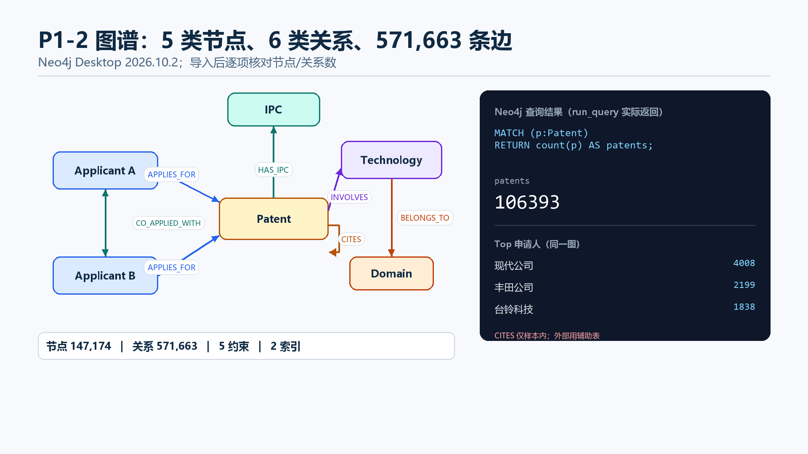

# P1 答辩 PPT 大纲（3 页）

> 适用：团队 12 分钟答辩 + 3 分钟演示，P1 部分约 **3 分钟**。
> 主线：**数据可信 → 图谱可查 → 边界说清**。
> P4 可直接按“画面文字”做页，讲稿按口语念；不要把所有数字都塞进一页。
> 三页 16:9 示意图已生成在 `assets/`，正文对应位置已插入，可直接复制到 PPT。

## 开场（约 10 秒，不单独做页）

> “我负责 P1 数据与图谱：把 16 个导出文件变成 7 张可校验的表，再变成能多跳查询的 Neo4j 图。核心不是图有多漂亮，而是每个数字能追溯、每个结论有边界。”

---

# 第 1 页：数据底座——142,112 行 → 106,393 件专利

## 页面标题

**P1-1 数据底座：按申请号去重，而不是按公开号**

> 已生成的 16:9 示意图，可直接作为 PPT 底图/版式参考。

## 画面布局

- 左侧 60%：横向四步流程图 / 漏斗
  1. `16 个 xlsx`：142,112 行 × 204 列
  2. `清洗 + 去重`：非主文献 3,668 行；2 条日期异常
  3. `7 张契约表`
  4. `106,393 件专利`
- 右侧 40%：七张表行数小表

| 表 | 行数 |
|---|---:|
| patents | 106,393 |
| applicants | 115,927 |
| patent_ipc | 306,023 |
| patent_topic | 104,723 |
| patent_efficacy | 391,642 |
| citations | 442,917 |
| cooperation | 9,826 |

- 页面底部三个胶囊：
  **IPC 99.0% · 主题 82.35% · 功效 89.41%**（分母 86,814 非外观设计）

## 页面文字（只放这些）

- 16 个导出批次，不是随机全量
- 同一申请多次公开 → 按 **申请号** 去重
- 代表公开号：发明授权 > 发明申请 > 实用新型 > 外观设计
- 非主文献 3,668 行不参与代表记录；外观设计保留，但不进技术表
- 2024—2025 不完整，趋势只用 2010/2015—2023

## 需要放的图片

1. **主图**：四步流程/漏斗（PPT 形状即可，不必截图）。
2. **右侧小表**：七张表行数（如上）。
3. 可选：`data/results/scale.json` 里 `dataset.tables` 的截图，增强“可追溯”感。

## 讲稿（约 60 秒）

> “先看数据底座。原始是 16 个 xlsx 合并的 142,112 行、204 列。我们没有按公开号计数，因为同一件申请会有申请、授权多次公开；按申请号去重后是 106,393 件。代表公开号按发明授权、发明申请、实用新型、外观设计优先级选，非主文献 3,668 行不参与代表记录。外观设计保留在专利表，但不写 IPC、主题、功效。最终是七张契约表，右边是行数。这里要强调：16 个批次是按法律状态分层导出的，1,008 行抽样里 14 个批次全是授权、2 个全是驳回，所以它是研究数据集，不是全量产业库；2024—2025 也不完整，趋势只用 2010/2015—2023。”

---

# 第 2 页：图谱——5 类节点、6 类关系、571,663 条边

## 页面标题

**P1-2 图谱：从七张表到可多跳查询的 Neo4j 图**

> 已生成的 16:9 示意图；右侧查询结果为 run_query 实际返回。

## 画面布局

- 左侧 55%：手绘/PPT 画的 Schema 图
  - 节点：Patent、Applicant、IPC、Technology、Domain
  - 关系：`APPLIES_FOR`、`CITES`、`HAS_IPC`、`INVOLVES`、`BELONGS_TO`、`CO_APPLIED_WITH`
  - `CITES` 箭头：引用方 → 被引方
- 右侧 45%：Neo4j Browser 截图
  - 查询：`MATCH (p:Patent) RETURN count(p);` 结果 **106393**
  - 或三跳查询结果截图（企业→专利→技术主题→领域）
- 底部横向计数条：
  **147,174 节点 / 571,663 关系 / 5 约束 / 2 索引**

## 页面文字（只放这些）

- 5 类节点：Patent 106,393；Applicant 27,557；IPC 13,166；Technology 50；Domain 8
- 6 类关系：APPLIES_FOR 115,927；CITES 35,114；HAS_IPC 306,023；INVOLVES 104,723；BELONGS_TO 50；CO_APPLIED_WITH 9,826
- 导入后逐项核对：节点/关系数与 parquet 完全一致
- 三条固定查询已跑通：申请人 Top10、企业→IPC、企业→主题→领域
- CITES 只建样本内 35,114 条；外部 407,803 条用 `external_citation_applicants.parquet` 补

## 需要放的图片

1. **Schema 图**：5 个节点框 + 6 条带箭头的关系；`CITES` 要标方向。
2. **Neo4j Browser 截图**：`MATCH (p:Patent) RETURN count(p);` 或三跳路径结果。
3. **可选**：`scale.json` 里 `relationships` 的截图，和底部计数条对应。

## 讲稿（约 60 秒）

> “七张表导入 Neo4j Desktop 2026.10.2，得到 147,174 个节点、571,663 条关系，5 个唯一约束、2 个索引。节点和关系数跟 parquet 逐项对得上，不是手画示意图。三条固定查询已经跑通：申请人 Top10、企业到 IPC、企业到技术主题到领域；还能跑企业到专利、到被引专利、再到申请人的两跳路径。CITES 只建样本内 35,114 条，外部 407,803 条没有建占位节点，企业级引用用外部主体明细补。所以这张图适合讲样本内路径，不能声称它是全产业引用网。”

---

# 第 3 页：质量与边界——哪些结论能说，哪些不能说

## 页面标题

**P1-3 质量与边界：把“不知道”也讲清楚**

> 已生成的 16:9 示意图；覆盖率、别名、CQ10 口径都在这页。

## 画面布局

- 左侧 40%：三张指标卡
  - IPC **99.0%**
  - 主题 **82.35%**（`（未细分）` 16,839 行单列）
  - 功效 **89.41%**
- 右上 30%：别名/合作小表
  - `Kia Corporation → 起亚`
  - `Hyundai Motor Co. → 现代公司`
  - `中国南方 → pending_review`
  - 合作边 9,826 → 9,750
- 右下 30%：CQ10 小流程图
  - 企业 A → 专利 → 被引主体 B
  - 标注：`Exposure = c(A,B)/C_A`；`C_A<30` 不判单点依赖
- 底部一行：
  **样例 481 / 全量 106,393；P5 抽样框 100 条**

## 页面文字（只放这些）

- 主题 `（未细分）` 16,839 行单列，不混入细粒度排名
- 别名 393 条，只是展示层；Kia 与 Hyundai 不合并；`中国南方` 待核
- 企业级引用 135,007 个主体对；CQ10 用 `external_citation_applicants` 明细，不拿 `citing_patent_count` 当引用次数
- 预计算指标：`company_metrics` 27,557 家；`topic_year` 1,293 行；`load_result` 读取
- 不能宣称：2024—2025 趋势、完整引用网络、精确企业层级、申请人国家

## 需要放的图片

1. **三张指标卡**：覆盖率用大数字，下面标分母。
2. **别名小表**：突出 Kia/Hyundai 分开、中国南方 pending。
3. **CQ10 流程图**：企业 A → 专利 → 外部主体 B，旁边写公式和阈值。
4. 可选：`manual_sample_100.csv` 前几行截图，说明 P5 抽样框已交。

## 讲稿（约 70 秒）

> “最后说边界，这部分比数字更重要。技术覆盖 IPC 99%、主题 82.35%、功效 89.41%，分母是 86,814 件非外观设计；主题里 16,839 行是 IPC 兜底`（未细分）`，页面单独列，不混进细粒度排名。企业别名 393 条只是展示层，Kia 和 Hyundai 不合并，中国南方标待核。企业级引用是 135,007 个主体对，但它是聚合，CQ10 要用外部引用明细算 c(A,B) 除以 C_A，不能拿 citing_patent_count 当引用次数。预计算指标 company_metrics 全量 27,557 家、topic_year 1,293 行，P2/P3 用 load_result 读。最后，2024—2025 不完整、CITES 只有样本内、16 批次不是随机全量，这些文档里都标了；P5 的 100 条抽样框已经交了，P/R/F1 还要人工标注后算。”

---

# 收尾一句（约 10 秒）

> “P1 的交付不是一张图，而是七张可校验的表、一个可复现的图、和一套写清楚边界的口径。P2/P3 可以直接按 `page_metrics.md` 取数，P4/P5 可以用 `data_profile.md` 和 `handoff.md` 写文档和评估。”

---

# 可能追问（背下来，不占页）

**Q1：为什么按申请号，不按公开号？**
> 同一申请会有申请、授权多次公开，按公开号会重复计数；申请号才是“一件专利”。代表公开号按授权优先，保证技术内容完整。

**Q2：为什么 CITES 只有 3.5 万条？**
> 只把样本内专利作为引用方；外部被引 40.7 万条没有建占位节点。企业级依赖用 `external_citation_applicants` 明细，所有结论标覆盖率和样本量。

**Q3：企业别名为什么只有 393 条？**
> 只做展示层，不做完整实体消解；合并同主体变体、截断名和少量集团级。Kia 和 Hyundai 不合并，`中国南方` 待核，避免把不同主体误并。

**Q4：2024—2025 为什么不能用？**
> 2025 年数据只到 8 月导出，2024 申请 6,519、2025 申请 236，断崖是采集不完整，不是产业下降。趋势窗口固定 2010/2015—2023。

**Q5：P/R/F1 呢？**
> 100 条分层抽样框已交 P5，`label_*` 列留空；P/R/F1 需要人工标注后计算，不能现在编一个数。
