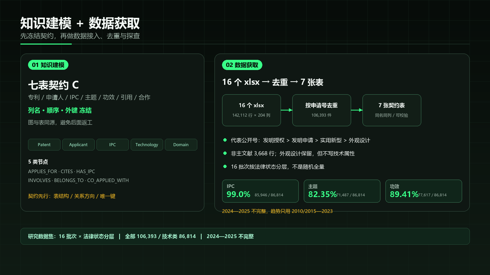
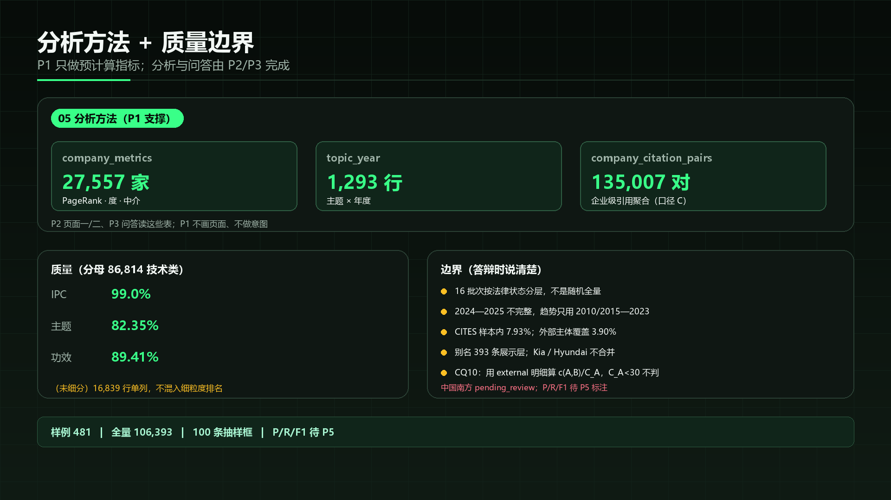

# P1 答辩 PPT 大纲（3 页）

> 适用：团队 12 分钟答辩 + 3 分钟演示，P1 部分约 **3 分钟**。
> 结构：按 **知识建模 → 数据获取 → 抽取融合 → 知识存储 → 分析方法** 五个模块讲。
> 风格：**深色背景 + 荧光绿**；三页示意图已生成在 `assets/`，同一套配色，可直接复制进 PPT。
> P1 主责前四个模块；“分析方法”只做预计算指标，分析与问答归 P2/P3。

## 开场（约 10 秒）

> “我负责 P1 数据与图谱，按五个模块讲：先做知识建模，再做数据获取、抽取融合、知识存储；最后说明分析方法里 P1 只做预计算，具体分析和问答由 P2/P3 完成。”

---

# 第 1 页：知识建模 + 数据获取

> 16:9 示意图，深色底 + 荧光绿；可直接作为 PPT 页面。

## 画面布局

- 左侧 **01 知识建模**：
  - 七表契约 C：专利 / 申请人 / IPC / 主题 / 功效 / 引用 / 合作
  - 列名、顺序、外键冻结
  - 5 类节点、6 类关系
- 右侧 **02 数据获取**：
  - `16 个 xlsx（142,112 行 × 204 列）→ 按申请号去重 → 106,393 件 → 7 张表`
  - 代表公开号：发明授权 > 发明申请 > 实用新型 > 外观设计
  - 非主文献 3,668 行；外观设计保留，但不写技术属性
  - 底部覆盖率：IPC 99.0% / 主题 82.35% / 功效 89.41%
- 底部警告：16 批次按法律状态分层，不是随机全量；2024—2025 不完整，趋势只用 2010/2015—2023

## 页面文字（只放这些）

- 先定契约，再做数据接入：表和图同源，避免返工
- 按 **申请号** 去重，不按公开号
- 16 个导出批次，不是全量产业库
- 全部专利 106,393；技术类（非外观设计）86,814

## 讲稿（约 65 秒）

> “第一页对应前两个模块。知识建模先把七表契约和 5 类节点、6 类关系冻结，列名、顺序、外键都不再改，这样后面的抽取和图谱不会反复返工。数据获取把 16 个 xlsx 合并成 142,112 行、204 列，再按申请号去重到 106,393 件；代表公开号按发明授权、发明申请、实用新型、外观设计的优先级选。非主文献 3,668 行不参与代表记录；外观设计保留在专利表，但不写 IPC、主题、功效。这里要说明，16 个批次是按法律状态分层导出的，1,008 行抽样里 14 个批次全是授权、2 个全是驳回，所以它是研究数据集，不是全量产业库；2024—2025 也不完整，趋势只用 2010/2015—2023。”

---

# 第 2 页：抽取融合 + 知识存储

> 16:9 示意图；右侧为 `run_query` 实际返回的查询结果卡片。

## 画面布局

- 左侧 **03 抽取融合**：
  - 申请人：分号拆、去后缀、别名 393 条
  - IPC 306,023 行 / 13,166 个
  - 主题 104,723 行 / 50 主题 / 8 领域
  - 功效 391,642 行
  - 引用 442,917 条（样本内 35,114）
  - 合作 9,826 对 / 6,704 件多申请人
  - `（未细分）` 16,839 行单列
- 右侧 **04 知识存储**：
  - Schema：5 类节点、6 类关系
  - 节点 147,174 / 关系 571,663 / 5 约束 / 2 索引
  - 查询：`MATCH (p:Patent) RETURN count(p) AS patents;` → **106393**
  - CITES 仅样本内；外部 407,803 条用辅助表

## 页面文字（只放这些）

- 抽取的是“实体 + 关系”，不是只拆表
- 图谱不是示意图：节点/关系数与 parquet 逐项一致
- 三条固定查询已跑通：申请人 Top10、企业→IPC、企业→主题→领域
- CITES 只建样本内 35,114 条；外部引用用 `external_citation_applicants`

## 讲稿（约 70 秒）

> “第二页是抽取融合和知识存储。申请人按分号拆、去 `[]` 和 `-C/-U/-R/-G` 后缀，再做展示层别名；技术侧拆出 IPC 306,023 行、主题 104,723 行、功效 391,642 行；关系侧有引用 442,917 条、合作 9,826 对。知识存储把七张表导入 Neo4j Desktop 2026.10.2，得到 147,174 个节点、571,663 条关系，5 个唯一约束、2 个索引；导入后逐项核对，节点和关系数与 parquet 完全一致。这句查询返回 106393，三条固定查询和企业→被引专利→申请人两跳都已经跑通。CITES 只建样本内 35,114 条，外部 407,803 条没有建占位节点，用辅助表补；所以这张图适合讲样本内路径，不能声称是全产业引用网。”

---

# 第 3 页：分析方法 + 质量边界

> 16:9 示意图；强调“P1 只做预计算，分析与问答由 P2/P3 完成”。

## 画面布局

- 顶部 **05 分析方法（P1 支撑）**：
  - `company_metrics` 27,557 家：PageRank、度、中介中心性
  - `topic_year` 1,293 行：主题 × 年度
  - `company_citation_pairs` 135,007 对：企业级引用聚合
  - 注：P2 页面一/二、P3 问答读这些表；P1 不画页面、不做意图
- 左下 **质量**：
  - IPC 99.0% / 主题 82.35% / 功效 89.41%（分母 86,814）
  - `（未细分）` 16,839 行单列
- 右下 **边界**：
  - 16 批次按法律状态分层，不是随机全量
  - 2024—2025 不完整
  - CITES 样本内 7.93%；外部主体覆盖 3.90%
  - 别名 393 条展示层；Kia/Hyundai 不合并；中国南方 `pending_review`
  - CQ10 用 `external_citation_applicants` 明细算 `c(A,B)/C_A`；`C_A<30` 不判单点依赖
- 底部：样例 481 | 全量 106,393 | 100 条抽样框 | P/R/F1 待 P5

## 页面文字（只放这些）

- 分析方法里 P1 只做预计算，不抢 P2/P3 的页面和问答
- 主题覆盖 82.35%，`（未细分）` 不混入细粒度排名
- 企业级引用是聚合，不是精确专利边
- 不能宣称：2024—2025 趋势、完整引用网络、精确企业层级、申请人国家

## 讲稿（约 75 秒）

> “第三页是分析方法和边界。分析方法里 P1 只做预计算：`company_metrics` 全量 27,557 家，含 PageRank、度、中介中心性；`topic_year` 1,293 行；企业级引用 `company_citation_pairs` 135,007 个主体对。P2 的页面一/二和 P3 的问答直接读这些表，P1 不画页面、不做意图。质量上，IPC 99%、主题 82.35%、功效 89.41%，分母是 86,814 件非外观设计；主题里 16,839 行是 IPC 兜底`（未细分）`，页面单独列。边界必须说清楚：16 批次不是随机全量，2024—2025 不完整，CITES 只有样本内 7.93%、外部主体覆盖 3.90%；别名 393 条只是展示层，Kia 和 Hyundai 不合并，中国南方待核。CQ10 要用外部引用明细算 c(A,B) 除以 C_A，不能拿 citing_patent_count 当引用次数。P5 的 100 条抽样框已经交了，P/R/F1 还要人工标注后算。”

---

# 收尾（约 10 秒）

> “P1 的交付是：可校验的七张表、可复现的 Neo4j 图、可被 P2/P3 直接读取的预计算指标，以及写清楚边界的口径文档。”

---

# 可能追问（背下来，不占页）

**Q1：你到底负责哪几个模块？**
> 知识建模、数据获取、抽取融合、知识存储四个模块由 P1 主导；分析方法里 P1 只做预计算指标，页面、图表和问答归 P2/P3。

**Q2：为什么按申请号，不按公开号？**
> 同一申请会有申请、授权多次公开，按公开号会重复计数；申请号才是“一件专利”。代表公开号按授权优先，保证技术内容完整。

**Q3：为什么 CITES 只有 3.5 万条？**
> 只把样本内专利作为引用方；外部被引 40.7 万条没有建占位节点。企业级依赖用 `external_citation_applicants` 明细，所有结论标覆盖率和样本量。

**Q4：企业别名为什么只有 393 条？**
> 只做展示层，不做完整实体消解；合并同主体变体、截断名和少量集团级。Kia 和 Hyundai 不合并，`中国南方` 待核，避免把不同主体误并。

**Q5：2024—2025 为什么不能用？**
> 2025 年数据只到 8 月导出，2024 申请 6,519、2025 申请 236，断崖是采集不完整，不是产业下降。趋势窗口固定 2010/2015—2023。

**Q6：P/R/F1 呢？**
> 100 条分层抽样框已交 P5，`label_*` 列留空；P/R/F1 需要人工标注后计算，不能现在编一个数。
